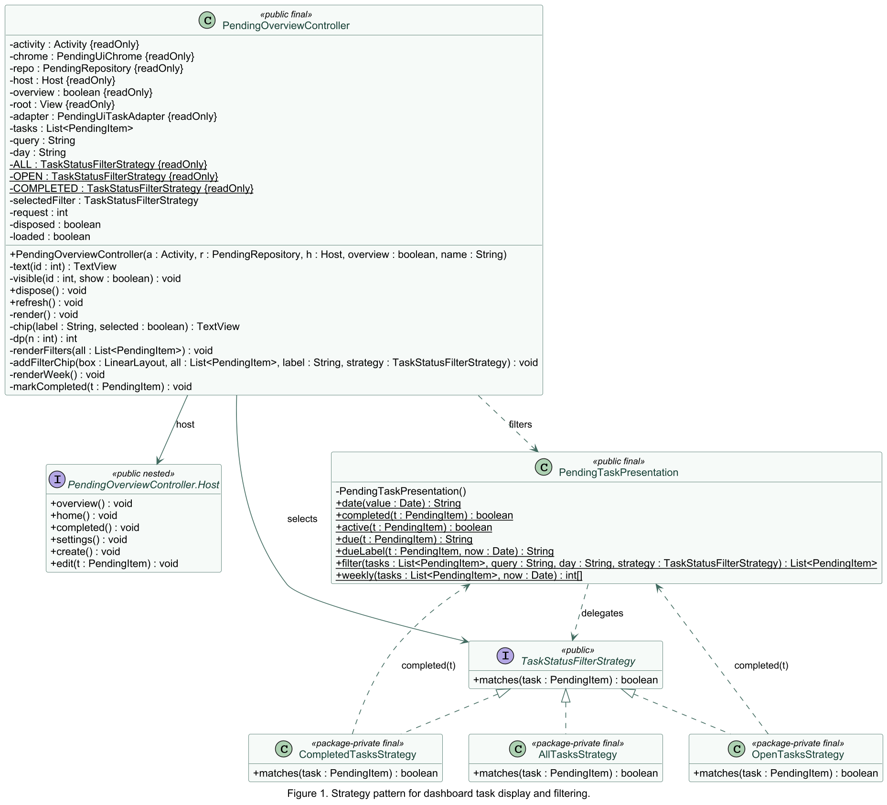

# Dashboard task display and filtering

CSC 4110 Assignment 4 · Software Design · Pending Android

**Contributor:** Renee  
**Design pattern:** Strategy  
**Branch:** `Renee_homework4`  
**Implementation commit URL:** <https://github.com/WSU-4110/Pending/commit/090e1cf917236648f32bbbfe2afdadb2a09d5b63>

## Design decision

The dashboard previously used the integers 0, 1 and 2 for All, Open and Completed. The controller supplied these values when rendering the list and computing counts. The presentation filter interpreted them for each task. A chip's position therefore determined its behavior.

The controller now binds each chip to a reusable strategy object. Selecting Open, for example, stores the OpenTasksStrategy instance in selectedFilter. PendingTaskPresentation.filter calls matches on that instance for each active task. Open and Completed use the same completed helper, which treats a non-null status of 3 or higher as complete. All accepts every active task.

## Behavior and trade-offs

The common filter still excludes deleted tasks, matches the selected due date, searches title, notes and waiting-on text, and sorts by due date. Home shows today's open tasks until a search spans dates. Overview counts each chip for the selected day. The summary totals and weekly progress use the full active list.

A new status rule can be tested independently and used by the existing pipeline. Adding it to the screen still requires a chip binding. Three small classes make the status rules explicit but add files to navigate. The controller still runs the filter for each chip count, so the change has the same repeated sorting cost as before.

## Verification

The baseline debug APK built and all 6 JVM tests passed. After the change, the debug APK built and all 10 JVM tests passed, with zero failures, errors or skips. The four new tests cover status boundaries and deletion, delegation, combined query/day/status filtering, and stable ordering without input mutation.

The instrumentation APK built. The connected test could not execute because ADB reported the emulator as unauthorized. Home and Overview interactions still require an on-device smoke check.

## UML class diagram

The diagram covers the dashboard filtering participants in com.pending.ui. Underlined members are static. The readOnly marker denotes a final field. Solid arrows show held references, dashed arrows show use, and hollow triangles point to the implemented interface.
